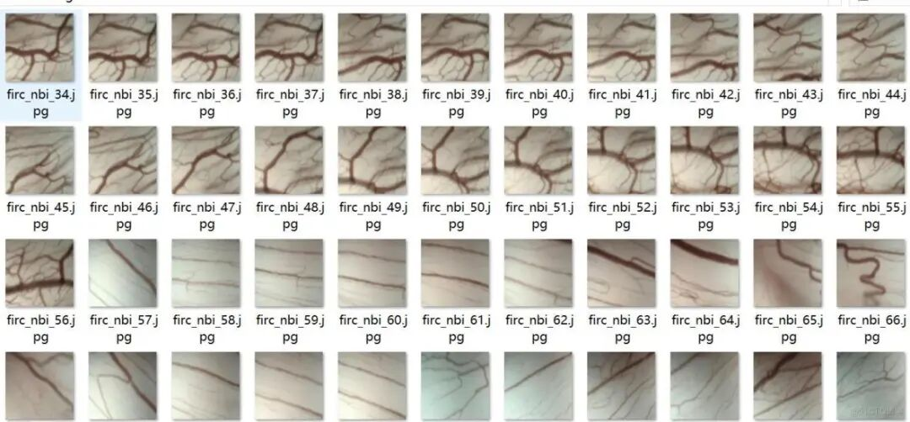
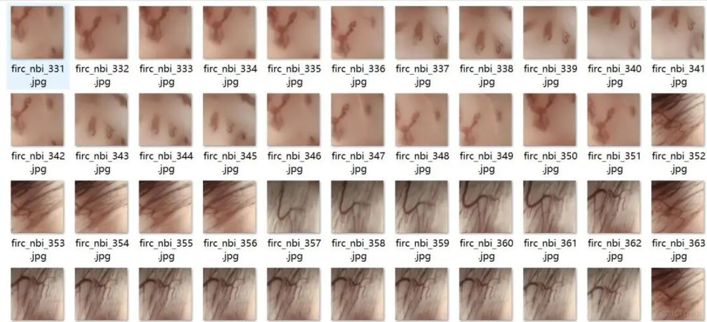
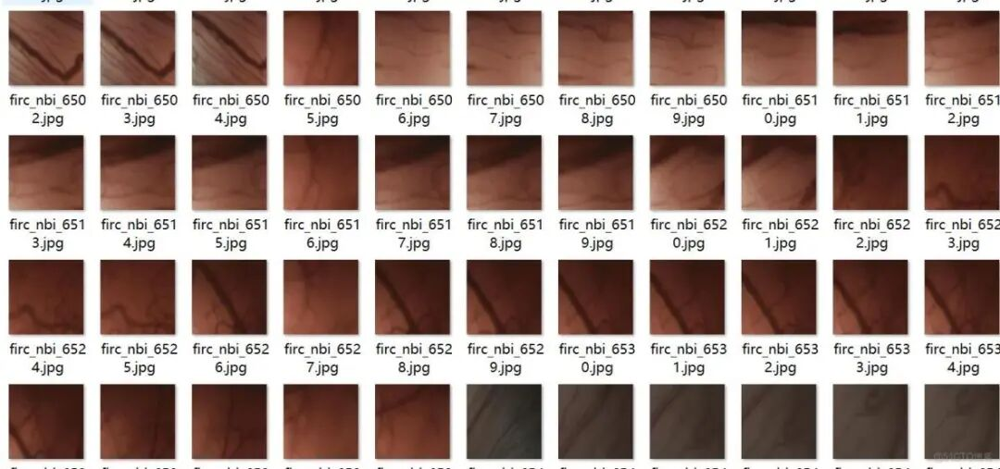
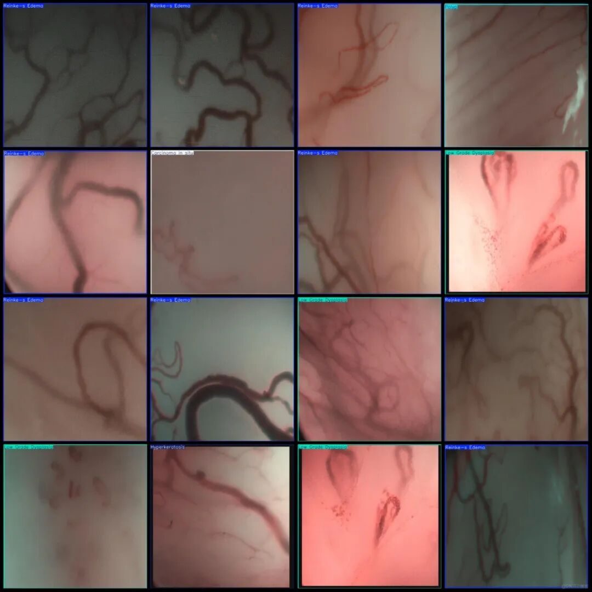

# NBI Medical Imaging Laryngeal Disease Detection Dataset VOC+YOLO format with 8571 images in 8 categories

## Note: The bounding boxes in the dataset are for whole images, please carefully review the annotation examples.

Dataset format: Pascal VOC format + YOLO format (txt file without split path, only contains jpg images and corresponding VOC format xml files and yolo format txt files)

Number of images (number of jpg files): 8571

Number of annotations (number of xml files): 8571

Number of annotations (number of txt files): 8571

Annotation category count: 8

Label category names (note that the order of categories in the YOLO format does not correspond to this, but is based on the labels folder's classes.txt): ["Carcinoma in situ", "Cyst", "High grade dysplasia", "Hyperkeratosis", "Low Grade Dysplasia", "Papillomatosis", "Polyp", "Reinke-s Edema"]

Number of boxes labeled in each category:

Carcinoma in situ (In situ carcinoma: Early carcinogenesis within the epithelium) Frame count = 542

Cyst (cyst: benign lesion containing fluid or semi-solid substances) frame count = 407

High grade dysplasia (high-grade dysplasia: premalignant high-risk lesion) frame count = 1008

Hyperkeratosis (cornification: abnormal thickening of the stratum corneum) frame count = 674

Low Grade Dysplasia (Mild Abnormal Proliferation: Mild Atypia) Frames = 1427

Papillomatosis (papillary tumor disease: multiple lesions associated with HPV infection) frame count = 1032

Polyp (Papilloma: proliferative tissue protruding from the mucosal surface) Frame count = 820

Reinke-s Edema (Syringeal Reinke edema: mucous membrane accumulation disease) frame count = 2663

Total frame count: 8573

Image resolution: 640x640

Using labelImg:

Annotation rules: Draw a rectangle around the category.

Important Notice: No

Special : This dataset does not guarantee the accuracy of the trained models or weight files.

Image Preview:

Annotation example:

## Payment

Here is a pay link on Stripe ( https://buy.stripe.com/3cs8yP7sY87d0vu9AB ). Please contact me lonlonago@foxmail.com after funding $89, and I will send you a complete data files , thank you!

